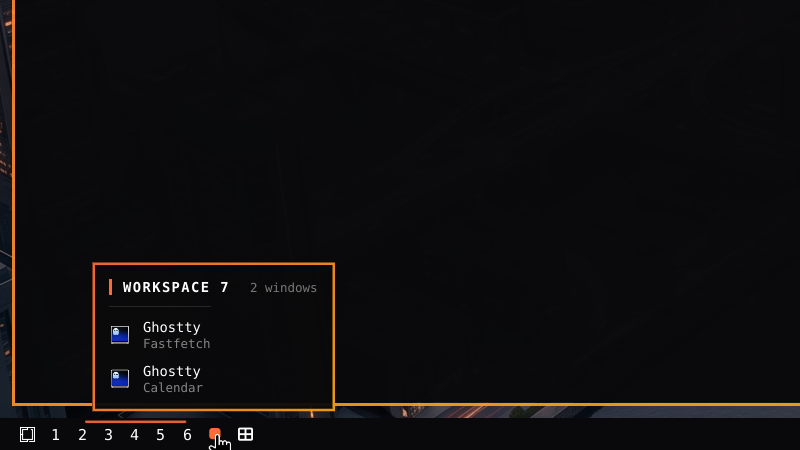
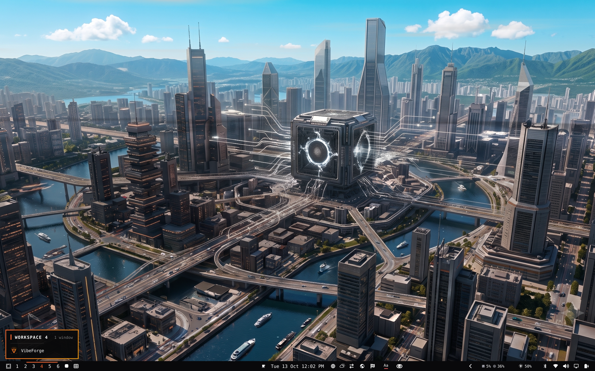

# Workspace Hover Cards



*Move onto the card and it grows into a live miniature of that workspace.*

Omarchy bar widget: workspace number indicators with a rich hover card that shows
exactly what is running on each workspace.

## Features

- **Live hover card** — hovering a workspace chip shows its name, window count,
  and a per-window list of app icon + window title, instead of the plain
  "Workspace N" tooltip bubble.
- **Accurate app icons** — resolves icons through desktop entries, handling both
  Wayland `appId` and XWayland `class` (e.g. `Google-chrome` → Google Chrome →
  the right icon).
- **Webapp icons** — browser windows are matched by the site name carried in the
  window title (e.g. "Home / X" gets the X icon), so webapps don't all show a
  generic browser icon.
- **Steam games** — `steam_app_<id>` surfaces are resolved to the actual game
  name and icon via the window title.
- **Live workspace miniature** *(new in 1.1.0)* — move the pointer from the chip
  onto the card and it grows into a live miniature of that workspace, with
  every window drawn where it really sits on screen over your wallpaper. Click a
  window in the miniature to jump straight to it. Hovering never switches
  workspaces, so it never steals focus.

## Requirements

- Omarchy with the Quickshell bar (plugin API `schemaVersion` 1)
- Hyprland (window positions and live captures use Hyprland IPC and the
  toplevel-export protocol)



*Resting on a chip shows the compact card: app icons and window titles.*

## Install

Install it from the [Omarchy plugin marketplace](https://plugins.omarchy.org/plugin.html?id=lonefox.workspaces), or from the command line:

```bash
omarchy plugin add https://github.com/L0nE-F0x/lonefox.workspaces.git --enable
```

Then place it on the bar. Replace the built-in workspaces widget if you use one:

```bash
omarchy bar put lonefox.workspaces --section left
# or, if it is already on the bar:
omarchy bar move lonefox.workspaces --section left
```

## Remove

```bash
omarchy plugin remove lonefox.workspaces --yes
```

## Changelog

### 1.1.0

- Hover card grows into a live miniature of the workspace when you move onto it.
- Click a window in the miniature to focus it.
- Geometry and dispatch helpers moved into `Preview.js`.

### 1.0.0

- First release: hover card with app icons and window titles, webapp and Steam
  game icon matching.

## License

MIT — see [LICENSE](LICENSE).